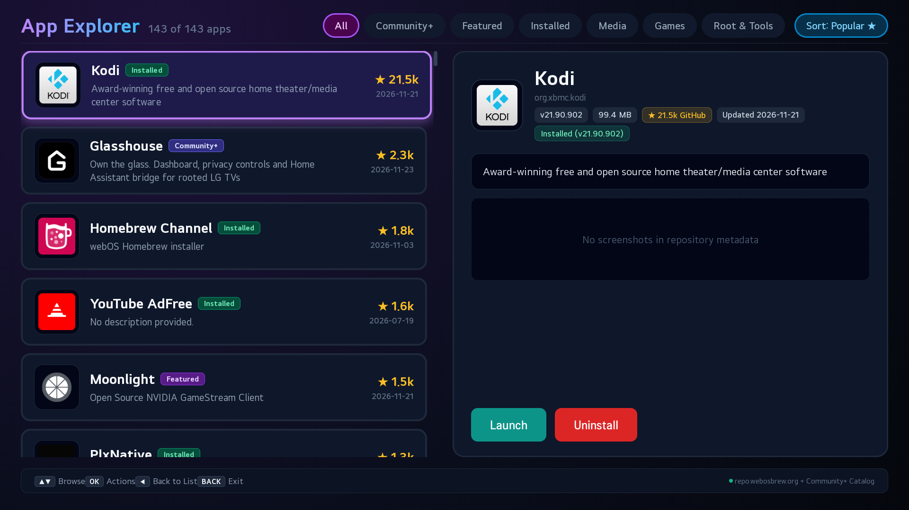

# PR Submission: App Explorer for webOS

**PR Title:**
```text
Add App Explorer for webOS (com.github.dasilva333.storeplus)
```

---

### PR Description Body:

```markdown
### New Application: App Explorer for webOS

**Package:** `com.github.dasilva333.storeplus`
**Category:** `utility`
**Source:** https://github.com/dasilva333/webos-storeplus
**Release:** `v1.0.0`

### Description
App Explorer for webOS is an independent third-party catalog browser and directory utility designed for sofa discovery on LG webOS TVs. It provides rich application overviews, inline descriptions, real-time GitHub star popularity rankings, and category filters while navigating the community repository.

### Features
* **GitHub Star Popularity Sorting**: Discover the most popular community packages ranked by live GitHub stars, or sort alphabetically, by release date, or by package size.
* **Roomy Couch-Friendly TV Cards**: Generous 144px card height designed for relaxed readability from across the room on OLED displays.
* **Split Detail Pane**: Inspect repository metadata, version badges, install size, maintainer info, and short/long descriptions before installing.
* **Smart Category Filters**: Quick navigation pills for All, Featured, Installed, Media, Games, and System/Tools.
* **Independent Package**: Runs as a standalone opt-in application (`com.github.dasilva333.storeplus`), providing alternative browsing without replacing or modifying core channel packages.
* **Full TV Remote Navigation**: Native 2D D-pad spatial navigation with high-visibility focus rings and Magic Remote air-mouse support.

### Screenshot


### Compatibility & Verification
* **Tested Device**: LG CX OLED (webOS 5.3.1 / Chromium 68)
* **Framework**: Vanilla HTML5/JS (ES5 compatible across webOS 1.x through webOS 11+)
* **Assets**: Verified open-source MIT license, 160px icon, 320px detail icon, and full 1920×1080 native screenshot included.

#### Submission checklist
- [x] I have tested this application on a real webOS TV.
- [x] I confirm that this submission complies with the repository rules.

#### AI-use declaration
- [x] AI assisted in code development, UI layout, and packaging.
```
