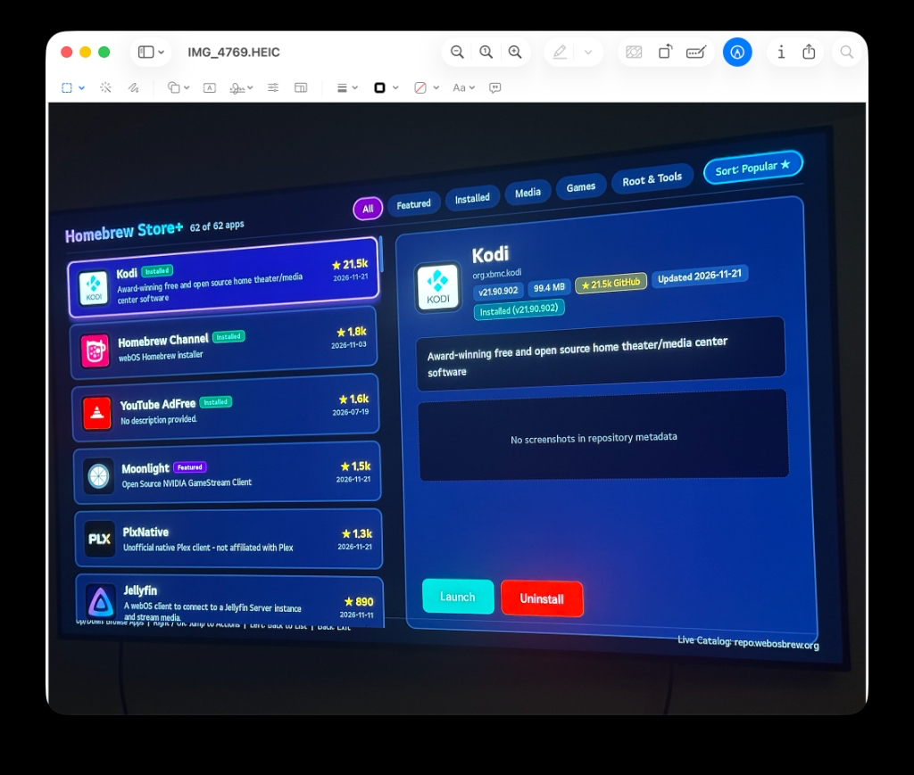

# Homebrew Store+ for LG webOS

A modern, fast split-pane Homebrew Channel application catalog browser for LG webOS TVs.

## Features

- **GitHub Popularity Ranking**: Displays real-time GitHub star counts for catalog applications.
- **Roomy TV Cards**: Generous 144px card height designed specifically for comfortable reading on 4K OLED displays.
- **Split Detail Pane**: Live app descriptions, repository metadata, version badges, install size, and direct Launch/Uninstall controls.
- **D-Pad Optimized**: Intuitive remote navigation with instant focus ring feedback.
- **Smart Category Filtering**: Quick navigation pills for All, Featured, Installed, Media, Games, and Root & Tools.

## Installation

Download the latest `.ipk` from GitHub Releases or install directly through the webOS Homebrew Channel repository (`repo.webosbrew.org`).

## License

MIT License - see [LICENSE](LICENSE).
